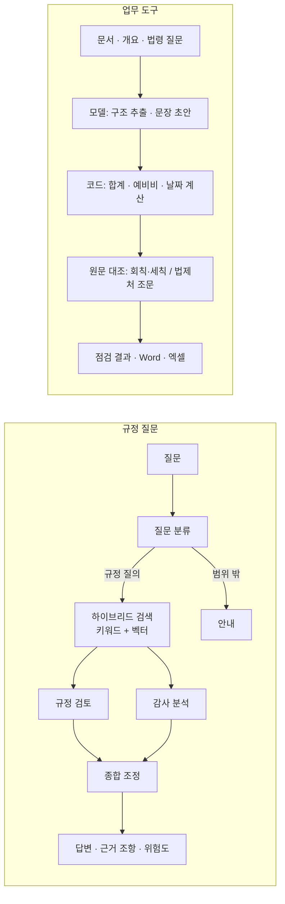
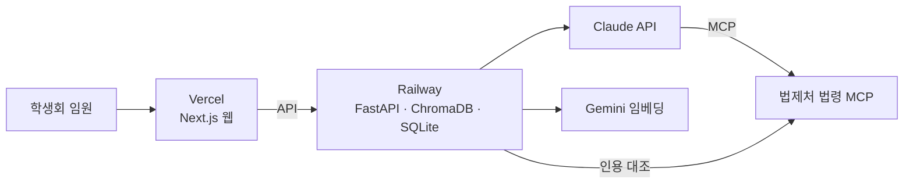

# 학생회 업무 AI

**규정 질문부터 예산 문서 검토·사업계획서·공문·법령 확인까지, 학생회 일을 한 곳에서 끝내는 업무 플랫폼**

인하대학교 학생회를 대상으로 실제 운영 중인 서비스입니다 · v2 규정 질문 AI를 v3 업무 플랫폼으로 리뉴얼했습니다.

---

## 왜 만들었나

학생회 임원은 매 학기 바뀌지만, 지켜야 할 규정은 회칙·세칙 여러 건에 흩어져 있습니다. 사업 하나를 하려면 규정을 찾고, 총회 양식에 맞춰 사업계획서와 예산안을 쓰고, 합계와 예비비를 손으로 맞추고, 사례금 원천징수나 개인정보 동의 같은 법령까지 따로 확인해야 합니다.

진짜 원인은 **정보가 없어서가 아니라 확인할 곳과 순서가 너무 많아서**입니다. 그래서 몰라서 규정을 어기고, 계산 실수가 감사에서 처분으로 돌아오는 일이 반복됩니다.

이 프로젝트는 그 과정을 **질문 하나와 문서 한 번 올리기**로 대체합니다. 규정은 조항 단위 출처와 함께 답하고, 금액·합계·날짜는 **코드가 계산**하며, 법령은 **법제처 원문과 대조한 조문만** 근거로 보여 줍니다.

---

## 기술 스택

<table>
<tr>
<td valign="top" width="33%">

### AI

**Claude Haiku 5.5** (분류·검토·종합·문서 추출·초안) 
**Gemini 임베딩** (검색) 
**LangGraph** (에이전트 흐름) 
**법제처 법령 MCP** (조문 검색·대조)

</td>
<td valign="top" width="33%">

### 백엔드

**FastAPI** · SSE 스트리밍 
**ChromaDB** (하이브리드 검색) 
**SQLite** (지표·계정) 
**Google 로그인** (학교 계정만)

</td>
<td valign="top" width="33%">

### 프론트엔드

**Next.js** · **React** · **TypeScript** 
**Tailwind CSS** 
**docx·exceljs** (Word·엑셀을 브라우저에서 생성)

</td>
</tr>
</table>

**CI/CD** ·  · GitHub Actions → Vercel(웹)·Railway(API)

| 영⁠역 | 선택 | 이유 |
|---|---|---|
| 모⁠델 | Claude Haiku 5.5 | 응답 지연 실험에서 가장 빠르고 저렴했습니다. 한 질문 약 $0.005 수준으로 학생회 예산 안에서 운영할 수 있습니다. |
| 검⁠색 | 키워드 + 벡터 융합 | "제32조" 같은 정확한 표현은 키워드가, 뜻이 같은 다른 표현은 벡터가 찾습니다. 한쪽만 쓰면 둘 중 하나를 놓칩니다. |
| 계⁠산 | 코드 | 합계·예비비·날짜를 모델에 맡기면 그럴듯하게 틀립니다. 모델은 단가·수량·문장만 내고 금액은 코드가 셉니다. |
| 법⁠령 | 법제처 공식 법령 MCP | 모델이 조문 번호를 지어내지 않도록 원문 도구로 찾고, 답한 뒤 인용 조문을 원문과 다시 대조합니다. |
| 파⁠일 생⁠성 | 브라우저 | 사업계획서·공문 내용을 서버에 남기지 않으려고 Word·엑셀을 사용자 브라우저에서 만듭니다. |

---

## 어떻게 동작하나

규정 질문은 **멀티에이전트 RAG**로, 업무 도구는 **추출은 모델·계산은 코드·근거는 원문 대조**로 나눠 처리합니다.

- **멀티에이전트:** 규정 검토와 감사 분석을 두 에이전트가 동시에 수행하고, 조정 에이전트가 하나의 권고로 종합합니다. 최종 위험도는 두 판정 중 높은 쪽을 코드가 고릅니다.
- **계산은 코드:** 문서 검토와 기획 도우미는 표 합계, 수입−지출, 예비비 10% 한도, 요일까지 코드가 다시 계산해 어긋난 곳만 알려 줍니다.
- **근거 대조:** 규정 메모는 실제로 검색된 조항만, 법령 답변은 법제처 원문으로 확인된 조문만 근거로 남기고 나머지는 지웁니다.
- **개인정보:** 질문·문서의 이름·전화번호·계좌는 모델에 보내기 전과 저장 전에 코드로 가립니다. 올린 파일 원본과 업무 도구 결과는 저장하지 않습니다.

### 배포 구조

규정 색인은 서버가 아니라 로컬에서 만들어 옮깁니다. 큰 감사보고서도 시간 제한 없이 색인하고, 로컬과 운영 색인이 똑같아 검증 결과가 그대로 운영에 적용됩니다.

---

## 실제 예시

> **질문 (법령 점검표 · 참가자 개인정보):** 행사 사진을 인스타그램에 올리려면 참가자 동의를 받아야 하나요?
>
> **답변:** 행사 사진에 참가자를 알아볼 수 있는 얼굴이나 영상이 담겨 있다면 개인정보에 해당해요. 개인정보처리자가 이를 제3자에게 제공하려면 원칙적으로 정보주체의 동의가 필요해요. … 학생회가 개인정보처리자에 해당하는지와 사진이 식별 가능한지는 사안마다 달라서 직접 판단하기 어려워요.
>
> 확인할 것 — 사진으로 참가자를 알아볼 수 있는지 / 동의받을 때 목적·항목·보유 기간·거부 권리를 함께 알리기 / 학생회 회칙·세칙의 사진 게시 절차는 규정 질문에서 확인
>
> **근거:** 「개인정보 보호법」 제2조(정의) · 제15조(개인정보의 수집·이용) · 제17조(개인정보의 제공) — 세 조문 모두 법제처 원문과 대조해 시행일과 원문 링크를 붙임

---

## 측정된 결과

기준: 2026년 11월 v2.18.0~v3.3.0에서 잰 값입니다. 실제 회칙·세칙·감사보고서 33건 색인과 2026년 2학기 총회 제출 자료를 썼습니다.

| 지⁠표 | 값 |
|---|---|
| 규⁠정 질⁠문 평⁠가⁠셋 | 52건 중 50건 통과 (실패 2건은 재실행 시 통과 — 문체 1, 평가 하네스 1) |
| 검⁠색 정⁠확⁠도 | 45/45 적중 · MRR 0.883 |
| 문⁠서 검⁠토 | 실제 예산 문서 12/12 정확 · 오탐 0 · 규정 메모 51 → 32개로 정리 |
| 총⁠회 자⁠료 회⁠귀 | 제출 자료 392개에 계산 검사를 다시 돌려 결과 변화 0 |
| 응⁠답 | 규정 질문 평균 10.7초 · 질문당 약 $0.005 |
| 법⁠령 질⁠문 | 실제 질문 3건 18~43초 · 건당 $0.01~0.02 · 인용 조문 전부 원문 대조 통과 |
| 자⁠동 테⁠스⁠트 | 서버 회귀 120건 · 웹 단위 34건 (키 없이 CI에서 실행) |

---

## 주요 기능

| 기⁠능 | 설명 |
|---|---|
| **규⁠정 질⁠문** | 로그인 없이 익명으로 묻고, 회칙·세칙 조항과 과거 감사 처분 사례를 근거로 답을 받습니다. |
| **문⁠서 검⁠토** | 예산안·정산서(PDF·한글·워드·엑셀)를 올리면 합계·예비비·표끼리 금액·엑셀 수식·날짜와 요일을 **계산으로** 검사하고, 규정 해석이 필요한 부분은 조항과 함께 알려 줍니다. |
| **기⁠획 도⁠우⁠미** | 행사 개요를 넣으면 총회 양식 사업계획서·예산안 초안을 만듭니다. 목적·주요 활동은 AI 초안으로 채울 수 있고, 금액·예비비·일정은 코드가 계산합니다. |
| **사⁠업⁠계⁠획⁠서 Word** | 표지·목차·기구표·사업 계획서·예산운영 계획서를 학생회 총회 자료와 같은 글자 크기·정렬로 만듭니다. 기구 이름과 대수는 계정별로 기억합니다. |
| **문⁠서 작⁠성** | 지급 확인서·경위서·예산 변경 사유서·공문·사령 공고를 Word로, 정산표를 엑셀로 만듭니다. 사령 공고는 동의·인준이 필요한 직책을 근거 조항과 함께 알려 줍니다. |
| **회⁠의⁠록 정⁠리** | 회의 메모를 안건·결정·할 일로 정리하고 회의록 서식으로 내려받습니다. |
| **법⁠령 점⁠검⁠표** | 강사 사례금·개인정보·주점·후원·저작권·공동구매·공연 안전을 주제별로 확인합니다. 조문은 법제처 원문을 확인한 것만 싣습니다. |
| **법⁠령 질⁠문** | 점검표에 없는 질문은 법제처 법령에서 조문을 찾아 답하고, 인용 조문을 원문과 대조해 링크를 붙입니다. |
| **내 작⁠업⁠함** | 기획 초안·검토 결과·회의록을 서버가 아닌 내 브라우저에 30일간 보관합니다. |
| **공⁠지·일⁠정** | 총회 공고 같은 일정을 홈 화면과 상단 공지로 알립니다. |

업무 도구는 인하대학교 Google 계정(@inha.edu)으로 로그인해 씁니다. 정기감사 대비 기능은 오픈을 준비하고 있습니다.

---

## 주의

- 학생회 업무를 돕는 참고 도구이며, 학생회 공식 해석이나 법률·세무 자문을 대신하지 않습니다. 중요한 결정은 원문과 담당 기관·전문가로 확인하세요.
- 규정 검색에 쓰는 회칙·세칙·감사보고서와 총회 제출 자료는 저장소에 포함하지 않습니다.
- 측정값은 위 기준일의 색인·평가셋 기준이며, 규정이 개정되거나 색인이 바뀌면 달라질 수 있습니다.
