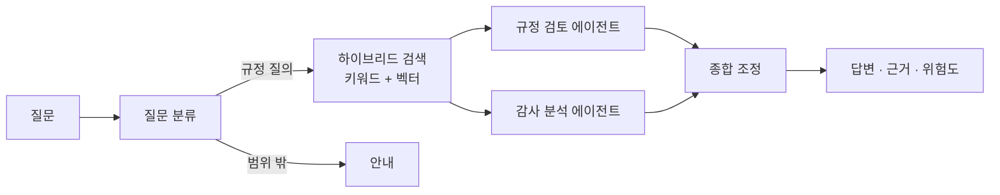

# 학생회 규정 AI 어시스턴트

**학생회 회칙·세칙·감사보고서를 근거로 "이거 규정 위반인가요? 감사 처분 받나요?"에 답하는 멀티에이전트 RAG 챗봇**

인하대학교 학생회를 대상으로 실제 운영 중인 서비스입니다.

---

## 소개

학생회 임원은 매 학기 바뀌지만, 지켜야 할 규정은 회칙·세칙 여러 건에 흩어져 있습니다.
그래서 **"몰라서" 규정을 어기고 감사에서 처분을 받는 일**이 반복됩니다.

이 서비스는 그 확인 과정을 **자연어 질문 하나**로 대체합니다. 질문을 받으면 관련 조항과 과거 감사 사례를 찾아,
위반 여부·위험도·처분 가능성을 **조항 단위 출처와 함께** 답합니다.

---

## 어떻게 동작하나

- **멀티에이전트:** 규정 검토와 감사 분석을 두 에이전트가 동시에 수행하고, 조정 에이전트가 하나의 권고로 종합합니다.
- **하이브리드 검색:** "제32조" 같은 정확한 표현은 키워드 검색이, 뜻이 같은 다른 표현은 벡터 검색이 찾고 순위를 융합합니다.
- **결정론적 위험도:** 에이전트의 판정을 구조화 출력으로 받아 최종 위험도는 코드가 계산합니다.
- **개인정보 보호:** 감사보고서의 실명은 답변과 저장 기록에서 코드로 한 번 더 지웁니다.

---

## 기술 스택

| 영역 | 사용 기술 |
|---|---|
| **AI** | Claude Haiku 5.5 (분류·분석·종합·문서 추출) · Voyage AI 임베딩 · LangGraph |
| **백엔드** | Python · FastAPI · ChromaDB · SQLite · SSE 스트리밍 |
| **프론트엔드** | Next.js · React · TypeScript · Tailwind CSS |
| **운영** | Docker · Railway · Vercel · GitHub Actions |

---

## 주의

- 학생회 규정 해석을 돕는 참고 도구이며, 공식 해석이나 법적 판단을 대신하지 않습니다.
- 학습·검색에 쓰는 내부 문서는 저장소에 포함하지 않습니다.
